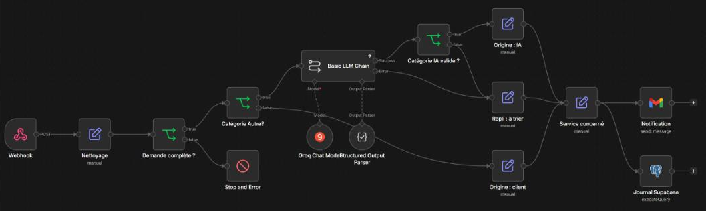
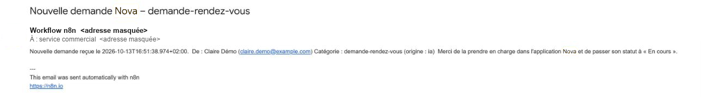
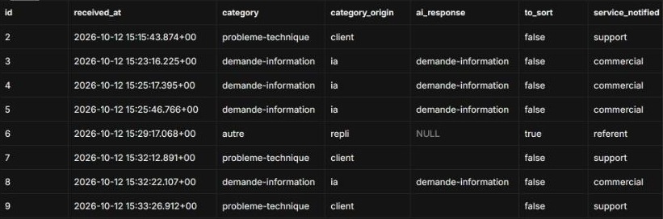

# Workflow n8n : prévenir le bon service à chaque nouvelle demande

*Projet réalisé dans le cadre de ma formation « Concevoir, développer et déployer des solutions IA-driven » (GDU / Coursenia, 2026). **Nova Services est une entreprise fictive** décrite par l'énoncé ; les demandes de test sont fictives.*

**En une phrase** : dans l'application [Nova Services](../nova-services/), une nouvelle demande attendait qu'un collaborateur pense à ouvrir son espace. J'ai conçu un workflow n8n qui prévient automatiquement le bon service, utilise une IA pour proposer une catégorie aux demandes ambiguës et journalise chaque traitement, avec des mécanismes de repli et d'alerte en cas d'erreur.

**Ce que ça change** : le service concerné est **prévenu automatiquement** · une demande ambiguë **ne bloque plus** le processus · chaque traitement est **tracé**.

**n8n · IA (Groq) bornée à une liste fermée · journal Postgres (Supabase) en accès « ajout seul » · workflow d'alerte en cas de panne · 10 cas de test, dont 3 pannes provoquées**

*Statut : prototype de formation. Le workflow est hébergé sur un serveur OVHcloud (Francfort, Union européenne), en HTTPS, avec un webhook protégé par une clé ; il a été testé par des requêtes envoyées sur son adresse de production. Depuis le 23 octobre 2026, l'application Nova l'appelle elle-même après chaque nouvelle demande.*

---

## 1. Le contexte

L'application Nova Services (réalisée au module précédent) centralise les demandes des clients : informations, problèmes techniques, rendez-vous, questions administratives. Les demandes sont bien enregistrées, mais **personne n'est prévenu** de leur arrivée.

## 2. Le problème

- Aujourd'hui, l'équipe doit **aller consulter l'application** pour découvrir les nouvelles demandes : une demande peut attendre si personne ne regarde. L'objectif est de passer d'une logique « **on va voir** » à une logique « **on est prévenu** ».
- Rien ne dit **qui** doit la prendre.
- Les demandes classées « Autre » par le client n'ont **aucun destinataire naturel**.

## 3. Comment j'ai cadré le besoin

Avant de construire, une analyse du processus existant (données reçues, étapes, rôles), puis un tri tâche par tâche : **automatiser, ou laisser à un humain ?**

| Tâche | Choix | Raison |
|---|---|---|
| Enregistrer la demande | Déjà fait par l'application | Un second enregistrement recréerait une double source de vérité |
| Proposer une catégorie si « Autre » | IA, sans blocage | Erreur peu coûteuse et corrigeable : on trace et on corrige après |
| Prévenir le bon service | Automatisé | C'est le cœur du gain |
| Répondre au client, changer un statut | **Humain seulement** | Le statut « En cours » indique qui a pris la demande : c'est la parade contre les doublons de traitement |

Règle retenue : **plus une erreur coûte cher, plus la validation humaine intervient tôt.**

## 4. Ce que j'ai construit

| Étape | Ce qui se passe |
|---|---|
| **Réception** | Webhook `POST`, corps JSON aligné sur le formulaire de l'application |
| **Contrôle** | Nom, email et description obligatoires ; sinon arrêt visible dans l'historique (Stop and Error) |
| **IA** | Seulement si la catégorie est « Autre ». Le modèle ne reçoit **que la description** et doit répondre en JSON structuré, parmi **5 codes fixés** |
| **Contrôle de l'IA** | Une réponse hors liste, ou une panne du fournisseur, envoie la demande « à trier » chez un référent : **la demande n'est pas perdue** |
| **Notification** | Email au service concerné (commercial, support, administration ou référent) |
| **Journal** | Une ligne par traitement dans la base de l'application : catégorie, **origine de la catégorie** (`client`, `ia`, `repli`), réponse brute de l'IA, service prévenu |
| **Alerte** | Un second workflow (Error Trigger) prévient le référent de **toute** exécution de production en échec : workflow, nœud, message, lien vers l'exécution |

## 5. Choix techniques, et pourquoi

| Choix | Pourquoi |
|---|---|
| **n8n** | Workflow lisible par un non-développeur, historique des exécutions intégré, auto-hébergeable (données maîtrisées) |
| **IA en chaîne simple, pas en agent** | Le besoin est une classification, pas une décision autonome : l'IA ne répond pas au client et ne modifie rien |
| **Sortie structurée + liste fermée + contrôle** | Un modèle de langage peut répondre n'importe quoi : sa réponse est vérifiée avant d'être utilisée |
| **Groq** (modèle `openai/gpt-oss-20b`) | Rapide, offre gratuite suffisante pour le volume ; conditions annonçant l'absence d'entraînement sur les données transmises (à revérifier avant un usage réel) |
| **Journal dans Postgres plutôt que Google Sheets** | Retour du mentor : une vraie base, reliée à la demande. Le journal vit dans la base de l'application (Supabase, région Paris), avec une clé étrangère vers la demande |

**Évolution du projet** : v1 avec un journal Google Sheets, v2 avec la gestion des pannes et le workflow d'alerte, **v3 avec le journal Postgres** après la revue du mentor, puis (v3.4) étapes regroupées en trois blocs repliables et commentés pour la lisibilité, la notification et le journal étant désormais enchaînés ; (v3.5) appel direct par l'application, chaque trace rattachée à sa demande ; (v3.6) objet de la demande dans le sujet de l'email, pour que le service repère d'emblée une demande transmise par l'agent IA ou urgente.

## 6. Qualité, sécurité, données personnelles

- **10 cas de test**, d'abord en mode test, puis sur l'adresse de production du workflow publié (n8n en local, puis, après son hébergement, rejoué sur le serveur pour une demande « Autre » classée par l'IA, un refus sans clé et une acceptation avec clé) : demande valide ; cinq demandes « Autre » classées par l'IA (dont les cas ambigus prix / facture) ; message vague ; demande sans email ; réponse de l'IA hors liste ; **panne réelle de l'IA** (modèle inexistant) ; lot de 5 demandes en production (4 réussies, 1 échec attendu) ; journal (lignes `client`, `ia`, `repli`) ; droits du rôle du journal ; version finale (v3). Tous conformes au résultat attendu.
- **Moindre privilège** : n8n écrit dans le journal avec un rôle Postgres dédié qui ne peut **qu'ajouter** des lignes à cette seule table (ni lecture, ni modification, ni suppression). Vérifié en ligne : lecture refusée, ajout accepté. La clé d'administration de la base n'est pas utilisée.
- **Requête paramétrée** : une valeur reçue ne peut pas être exécutée comme du SQL.
- **Connexion chiffrée et vérifiée** : SSL avec contrôle du certificat (certificat racine de Supabase fourni à n8n).
- **Secrets** : uniquement dans les identifiants chiffrés de n8n ; l'export du workflow a été vérifié (références seulement, aucune clé).
- **Données personnelles** : l'IA ne reçoit ni nom, ni email, ni téléphone ; l'email de notification ne reprend pas la description ; le journal n'en contient aucune, et ses lignes deviennent anonymes quand la demande est purgée.
- **Diagnostic** : méthode documentée à partir de l'historique des exécutions (quel nœud, quel message, quelles données en entrée).

## 7. Résultats

C'est un **exercice de formation** : pas de mesure chez un vrai client. Ce qui est vérifié : le workflow publié (n8n hébergé sur un serveur OVHcloud à Francfort), appelé par des requêtes de test, reçoit une demande, prévient le bon service, journalise le traitement, et chaque cas de panne testé aboutit à un repli ou à une alerte. Depuis le 23 octobre 2026, **l'application en ligne l'appelle elle-même** après chaque nouvelle demande (contrôlé sur une vraie demande : email au bon service, trace dans le journal rattachée à la demande). Ce qui ne l'est pas encore : la détection d'une panne de n8n lui-même (si le serveur est arrêté, aucune alerte ne part ; l'application relance pendant 24 heures, puis signale l'échec dans sa propre supervision).

*Ordre de grandeur, à titre d'illustration* : le gain estimé retenu dans n8n est de **3 minutes par demande** (lire, classer, transmettre). Surtout, une demande n'attend plus que quelqu'un pense à regarder. Dans une vraie mission, ce chiffre se mesure pendant le diagnostic.

## 8. Limites et suites

- **Hébergement fait, sauvegarde à mettre en place** : n8n tourne sur un serveur OVHcloud à Francfort (**Allemagne, Union européenne**, pas en France), en HTTPS derrière un proxy, serveur sécurisé (connexion par clé uniquement, pare-feu). Les données d'exécution (qui contiennent les données reçues) sont donc dans l'Union européenne ; la base de Nova reste à Paris. La sauvegarde régulière du volume n8n reste à mettre en place.
- **Branchement fait (23/10)** : l'application appelle le webhook après l'enregistrement de chaque demande, avec relance toutes les 15 minutes pendant 24 heures en cas d'échec. Reste prévue : l'écriture de la catégorie proposée par l'IA dans la demande elle-même, avec un accès limité à ce seul droit.
- **Panne de n8n lui-même non détectée** : le workflow d'alerte ne peut rien signaler si n8n est arrêté. Une surveillance extérieure (vérification régulière que le service répond) serait à ajouter.
- **Webhook protégé par une clé** dans l'en-tête de la requête (sans clé, la requête est refusée) : la clé est conservée côté serveur de l'application (variable d'environnement), jamais dans le navigateur.
- **Notifications de test** (alias d'une boîte personnelle) et autorisations Google en mode Test, à renouveler régulièrement.
- **Durée de conservation des exécutions n8n** (qui contiennent les données reçues) : fixée à 14 jours (effacement automatique) pour l'exercice, à confirmer avec le client.

Les conditions de mise en production sont listées dans la documentation du livrable (hébergement, protection du webhook et durée de conservation faits ; restent la sauvegarde, les adresses réelles, la publication de l'application Google, le RGPD et la surveillance).

## 9. Ce que ça dit de ma méthode

Je commence par décider ce qui doit rester humain, puis j'automatise le reste. Je traite l'IA comme une source non fiable : sa réponse est bornée, vérifiée, et une panne a toujours un chemin de repli. Je teste les pannes autant que les cas normaux, et je documente ce que la solution ne fait pas.

---

*Jean-Baptiste Josselin · Intégrateur automatisation & no-code · [LinkedIn](https://www.linkedin.com/in/jean-baptiste-josselin-a5b268240/)*
