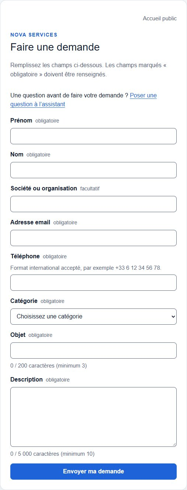
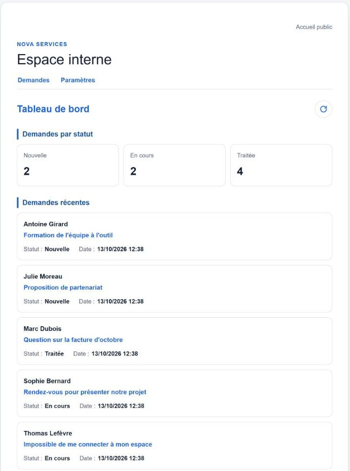
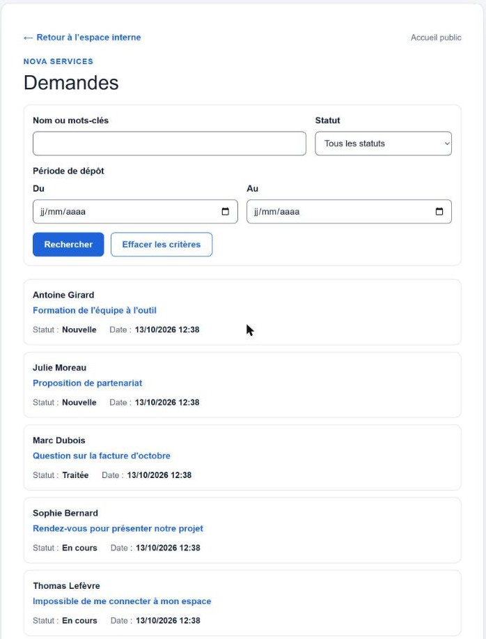
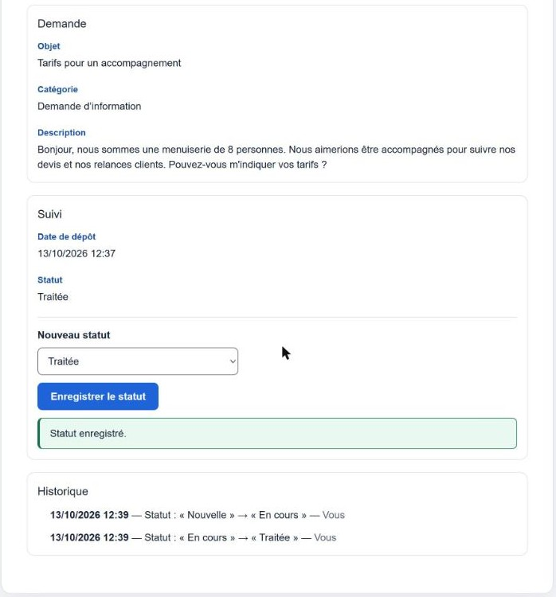
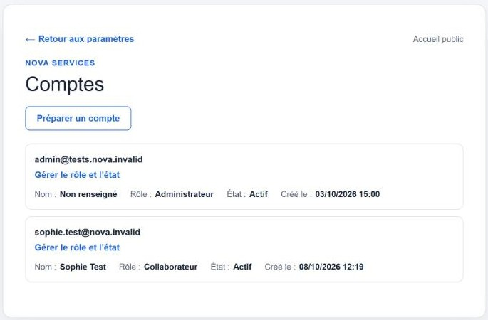

# Nova Services : centraliser et suivre les demandes clients

*Projet réalisé dans le cadre de ma formation « Concevoir, développer et déployer des solutions IA-driven » (GDU / Coursenia, 2026). **Nova Services est une entreprise fictive** décrite par l'énoncé ; aucune donnée réelle n'est utilisée.*

**En une phrase** : une petite entreprise de services recevait ses demandes par email et téléphone, les recopiait dans plusieurs fichiers et en perdait le fil. J'ai conçu, développé et mis en ligne une application qui centralise toutes les demandes et montre à l'équipe ce qui reste à traiter.

**Application en ligne · 3 profils (client, collaborateur, administrateur) · 414 tests automatisés · 196 parcours complets simulés, tous réussis · automatisation n8n branchée et contrôlée en ligne**

*Les 414 tests vérifient chaque fonction séparément ; les 196 scénarios rejouent des parcours d'utilisateur de bout en bout. Ce sont deux niveaux de contrôle différents, pas 610 tests indépendants.*

Application en ligne (démonstration) : [nova-services-demandes.vercel.app](https://nova-services-demandes.vercel.app)  
Code source : dépôt privé (projet de formation), présentation possible sur demande.

---

## 1. Le contexte

Nova Services accompagne des professionnels dans leurs projets numériques. Chaque semaine, l'équipe reçoit des demandes de clients et de prospects : informations, problèmes techniques, rendez-vous, questions administratives.

## 2. Le problème

- Les demandes arrivent **par email et par téléphone**, sans point d'entrée unique.
- Elles sont **recopiées à la main** dans différents fichiers.
- Résultat : des **oublis**, des **doublons**, et **aucune visibilité** sur ce qui est en cours ou terminé.

## 3. Comment j'ai analysé le besoin

Avant d'écrire une ligne de code : identification des utilisateurs (client, collaborateur, administrateur), de leur parcours et des règles à respecter, puis découpage du projet en étapes avec, pour chacune, des **critères de réussite vérifiables** (méthode BMAD, utilisée en formation).

## 4. Mon rôle

J'ai mené le projet de bout en bout, seul :

- **définir les parcours** des trois profils et les règles métier (qui voit quoi, qui peut changer un statut) ;
- **structurer les données et les droits d'accès** (ce que la base accepte ou refuse, pour chaque profil) ;
- **piloter le développement assisté par IA** : fixer les critères de chaque étape, faire relire le travail d'une IA par une autre, trancher les écarts, simplifier quand c'était trop compliqué ;
- **valider** : faire passer et maintenir les tests, vérifier les cas d'erreur ;
- **mettre en ligne et préparer l'exploitation** : déploiement, supervision, retour arrière, sauvegarde et restauration.

## 5. Ce que j'ai construit

| Pour qui | Ce que ça permet |
|---|---|
| **Le client** | Déposer sa demande dans un formulaire simple et recevoir une **confirmation d'enregistrement** |
| **Le collaborateur** | Retrouver toutes les demandes au même endroit, les **rechercher et filtrer**, suivre leur statut (**Nouvelle, En cours, Traitée**) et l'**historique** de chaque traitement |
| **L'administrateur** | Gérer les **comptes et les droits** de l'équipe, et les paramètres (catégories) |

*Captures réalisées avec des demandes fictives.*

## 6. Ce que ça apporte, et avec quels outils

| Bénéfice pour l'entreprise | Comment |
|---|---|
| **Une seule source** pour toutes les demandes, plus de ressaisie | Base de données **Supabase**, hébergée à Paris |
| **Chacun ne voit que ce qu'il doit voir** | Comptes et droits gérés par la base elle-même |
| **Accessible partout**, sans installation | Application web **Next.js**, informations sensibles gardées côté serveur |
| **Une mise à jour ratée se corrige vite** | Mise en ligne avec **Vercel** : retour à la version précédente possible |

Développement **assisté par l'IA** (Claude Code, Codex), avec une règle constante : c'est moi qui fixe les critères, qui fais vérifier chaque étape et qui tranche.

## 7. Qualité et sécurité

- **414 tests automatisés** (chaque fonction vérifiée séparément) et **196 scénarios de bout en bout** (un utilisateur simulé parcourt l'application), tous réussis.
- **Accès protégés** : seuls les collaborateurs actifs voient les demandes ; un compte désactivé est refusé dès l'action suivante, même par un accès direct à la base.
- **Données et secrets** : base hébergée en France (Paris) ; automatisation n8n hébergée dans l'Union européenne (Allemagne) ; données de démonstration fictives, mots de passe et clés jamais écrits dans le code.
- **Erreurs gérées** : si la base ne répond pas, le client voit un message clair, sa saisie est conservée et l'envoi ne crée pas de doublon. Jamais de faux « c'est enregistré ».
- **Exploitation préparée** : supervision des erreurs, procédure de retour arrière, sauvegarde et restauration (testées en environnement isolé).

## 8. Résultats

C'est un **exercice de formation** : pas de mesure chez un vrai client. Ce qui est vérifié : l'application est en ligne, le dépôt d'une demande, son enregistrement et son traitement fonctionnent, et tous les tests passent.

*Ordre de grandeur, à titre d'illustration seulement* : pour une équipe qui reçoit 50 demandes par semaine et passe 3 minutes à recopier et classer chacune, c'est environ **2 h 30 par semaine** qui disparaissent, sans compter les oublis évités. Dans une vraie mission, ce chiffre se mesure pendant le diagnostic.

## 9. Limites et suites

- La version en ligne est une **démonstration** (environnement de développement, données fictives). Une vraie mise en service demanderait un environnement dédié, l'activation des sauvegardes sur la base hébergée et des choix à faire avec le client : durée de conservation, responsable du support.
- **Automatisation branchée et contrôlée en ligne (n8n, formation)** : être **prévenu** au lieu d'aller voir. À chaque nouvelle demande, le bon service reçoit un email ; si le client a choisi « Autre », une IA propose une catégorie (sans jamais répondre au client ni changer un statut) ; chaque traitement est tracé sans donnée personnelle ; toute panne déclenche une alerte. Ce prototype fonctionne et ses cas d'erreur sont testés. Il est **hébergé sur un serveur OVHcloud** (Francfort, Union européenne, HTTPS, webhook protégé par une clé). **Depuis le 23 octobre 2026, l'application l'appelle elle-même** : la demande est enregistrée d'abord, la notification suit ; si n8n ne répond pas, une relance repasse toutes les 15 minutes pendant 24 heures, puis l'échec est signalé dans la supervision. Contrôlé en ligne : une vraie demande a déclenché l'email au bon service et sa trace dans le journal. Reste prévue : l'écriture de la catégorie proposée par l'IA dans la demande elle-même.

## 10. Ce que ça dit de ma méthode

Je pars du métier (qui fait quoi, où se perd le temps) avant de choisir l'outil. Je livre des solutions **testées, documentées et expliquées**, et je dis clairement ce qu'elles ne font pas. L'IA me fait gagner du temps ; elle ne décide pas à ma place.

---

*Jean-Baptiste Josselin · Intégrateur automatisation & no-code · [LinkedIn](https://www.linkedin.com/in/jean-baptiste-josselin-a5b268240/)*
